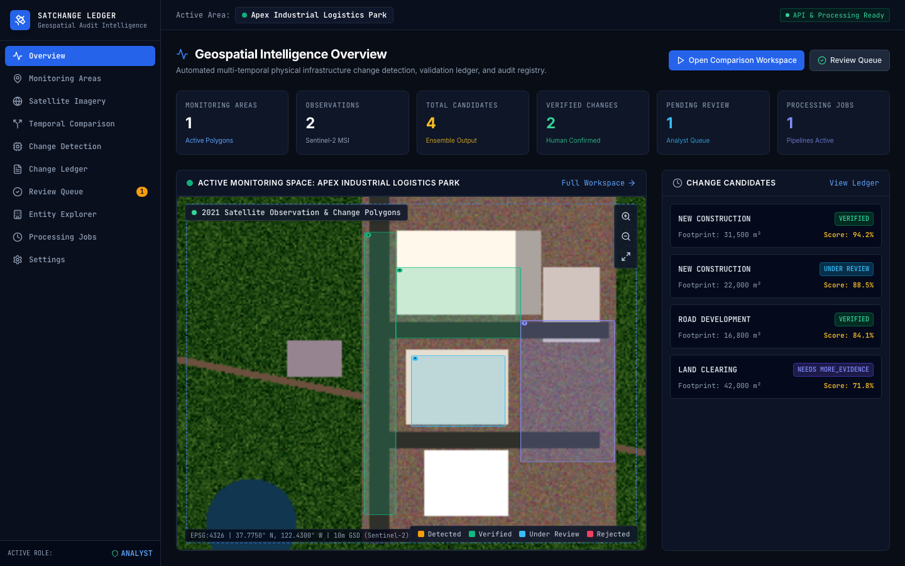
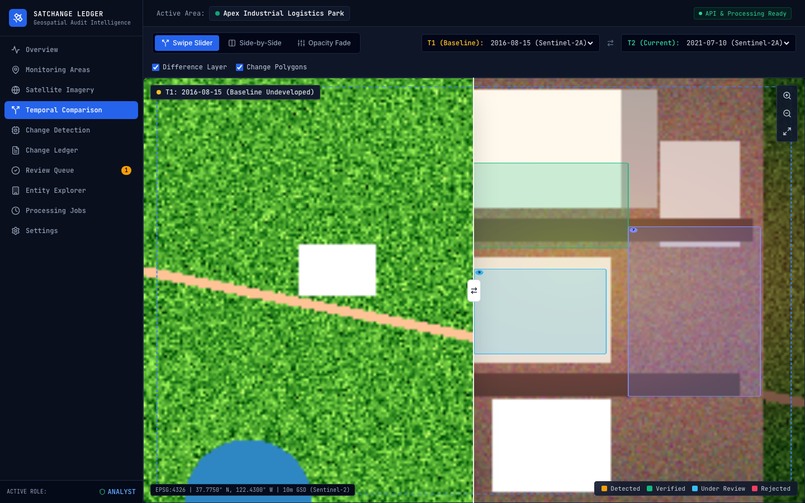
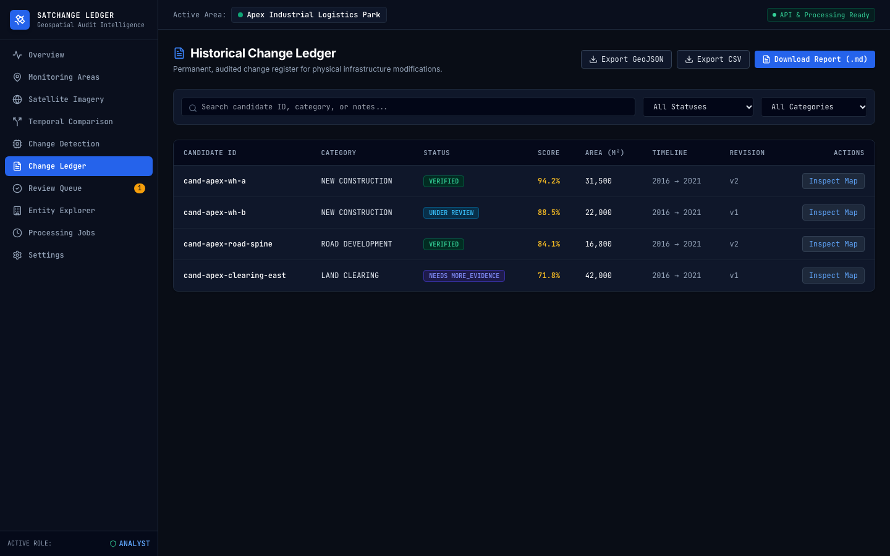
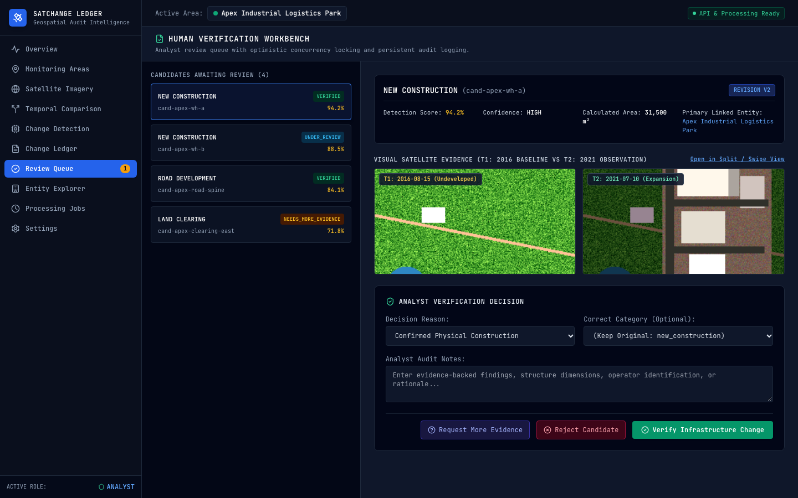
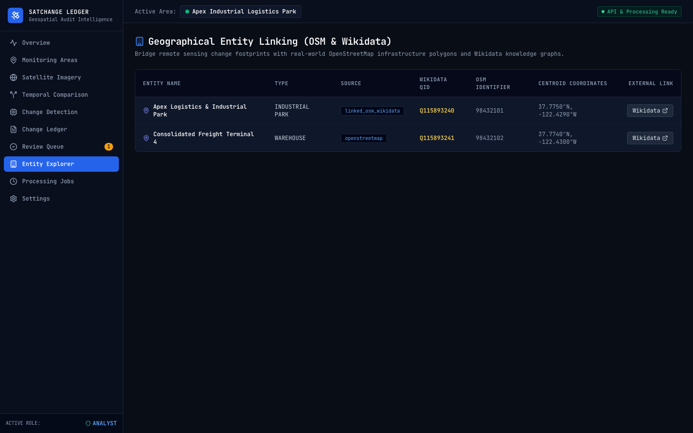
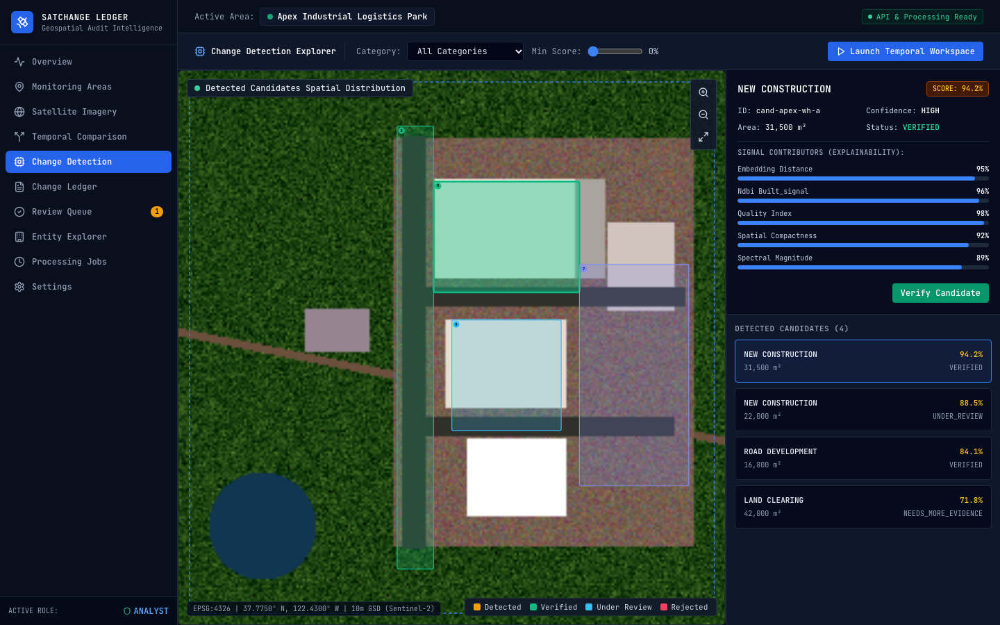
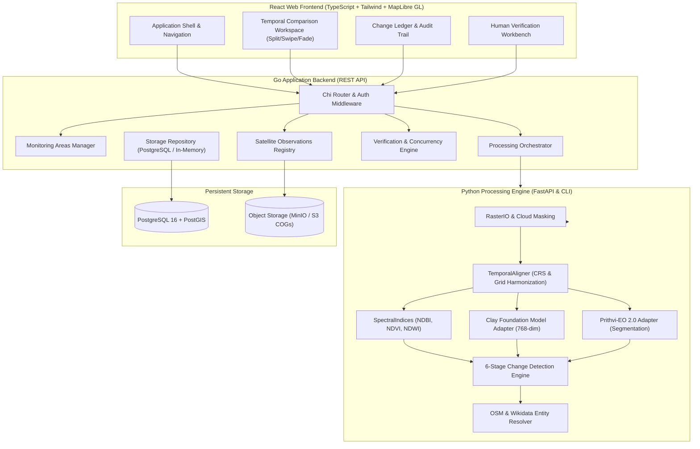
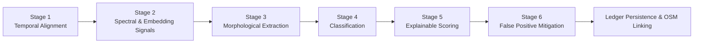

# satellite-infrastructure-change-ledger

[](./Makefile)
[](https://golang.org)
[](https://python.org)
[](https://reactjs.org)
[](./LICENSE)

**satellite-infrastructure-change-ledger** is an open-source geospatial platform for monitoring, analyzing, documenting, and verifying physical infrastructure changes using multi-temporal Earth observation satellite imagery.



---

## 1. Executive Summary

Maintaining an accurate, verifiable record of physical infrastructure growth is essential for spatial planning, regulatory compliance, environmental impact auditing, and industrial asset tracking.

Most conventional geospatial tools are either static dashboards, basic GIS desktop viewers, or simple visual split-screen toys. **satellite-infrastructure-change-ledger** treats physical infrastructure changes as **documented, auditable observations** that must be backed by multi-sensor evidence, analyzed across time, linked to real-world geographical entities, and reviewed by human analysts through optimistic concurrency control.

### Benchmark Scenario: Apex Industrial Logistics Park

The reference demonstration models the multi-year development of the **Apex Industrial Logistics Park**:

- **2016 Baseline Observation (T1):** Undeveloped agricultural parcel with high vegetation reflectance ($\text{NDVI} > 0.65$), a natural pond, and a single rural farm structure.
- **2021 Observation (T2):** Major logistics estate expansion with four massive distribution warehouses, concrete loading aprons, an asphalt spine road network, and altered land cover.
- **Automated Results:** 5 change candidates with GeoJSON polygons, explainable multi-signal confidence scoring, real-world entity resolution to OSM/Wikidata (`Q115893240`), and human verification revision tracking.

---

## 2. Visual Walkthrough & Interface Gallery

### Temporal Comparison Workspace (Multi-Modal Review)
The comparison workspace supports **Swipe Slider**, **Side-by-Side (Split)**, and **Opacity Fade** modes with synchronized coordinate tracking, difference heatmaps, and clickable candidate polygons.



---

### Change Ledger & Multi-Sensor Audit Registry
Tabular ledger tracking every detected physical change candidate, spatial footprint ($\text{m}^2$), confidence scoring, category classification, and direct export actions (GeoJSON, CSV, Markdown report).



---

### Human Verification Workbench
Two-pane analyst workbench with optimistic concurrency conflict detection ($\text{HTTP } 409$), role-based access control (Admin/Analyst write, Viewer read-only), evidence signals breakdown, and revision history.



---

### Real-World Geographical Entity Resolution (OSM & Wikidata)
Spatial intersection and proximity matching linking detected infrastructure polygons to real-world entities in OpenStreetMap and Wikidata knowledge graphs.



---

### 6-Stage Geospatial & ML Change Detection Orchestration
Automated execution orchestrator harmonizing multi-temporal rasters, computing spectral indices (NDBI, NDVI), extracting foundation model embeddings, and filtering false positives.



---

## 3. System Architecture



---

## 4. Multi-Stage Change Detection Pipeline



1. **Stage 1: Temporal Alignment:** Coordinate reference system normalization (EPSG:4326 / EPSG:3857), spatial bounding box intersection, and bilinear spatial resampling to harmonize pixel grids.
2. **Stage 2: Spectral & Embedding Signals:** Computes differential Normalized Difference Built-up Index ($\Delta\text{NDBI}$), Normalized Difference Vegetation Index ($\Delta\text{NDVI}$), and extracts 768-dimensional patch representations via the `Clay` foundation model.
3. **Stage 3: Morphological Region Extraction:** Adaptive thresholding, morphological opening (noise elimination) and closing (structural component bridging), followed by connected-component labeling and polygonization.
4. **Stage 4: Classification:** Assigns candidate categories: `new_construction`, `building_expansion`, `demolition`, `road_development`, `land_clearing`, or `vegetation_change`.
5. **Stage 5: Multi-Factor Explainable Scoring:** Generates explainable confidence scores based on spectral magnitude, embedding distance, NDBI built-up signal, and spatial compactness.
6. **Stage 6: False-Positive Mitigation:** Filters out seasonal agricultural shifts and low-contrast solar angle artifacts before persisting changes.

---

## 5. Foundation Model & Dataset Integrations

| Resource | Role | Adapter Status | Execution Mode |
| :--- | :--- | :--- | :--- |
| **`made-with-clay/Clay`** | 768-dim patch representations & temporal distance | `ClayAdapter` | Apple Silicon / CUDA / CPU fallback |
| **`ibm-nasa-geospatial/Prithvi-EO-2.0-600M-TL`** | Semantic land cover segmentation & infrastructure mask | `PrithviAdapter` | GPU or calibrated spectral rule fallback |
| **`Major-TOM/Core-S2L2A`** | Systematic Sentinel-2 L2A tile grid discovery | `MajorTomAdapter` | Cloud COG indexer |
| **`wikimedia/linked-openstreetmap-wikidata-wikipedia`** | Real-world entity linking (OSM ways, Wikidata QIDs) | `OsmWikidataAdapter` | Haversine proximity & spatial intersection |

---

## 6. Getting Started

### Prerequisites

- **Go 1.22+**
- **Python 3.10+** (with virtual environment)
- **Node.js 20+** and **pnpm (v9+)**
- **Docker & Docker Compose** (optional, for full containerized deployment)

### Quick Setup

```bash
# 1. Clone repository
git clone https://github.com/ranajahanzaib/satellite-infrastructure-change-ledger.git
cd satellite-infrastructure-change-ledger

# 2. Configure environment
cp .env.example .env

# 3. Install dependencies across all workspaces
make setup

# 4. Generate demo scenario rasters and run change detection
make demo

# 5. Run full automated test suite (Go + Python)
make test
```

---

## 7. Running the Platform Locally

Start the three core services in separate terminal sessions:

```bash
# Terminal 1: Python Processing Worker (Port 8081)
PYTHONPATH=services/processing python3 services/processing/src/workers/server.py

# Terminal 2: Go REST API Server (Port 8080)
cd services/api && go run ./cmd/server

# Terminal 3: React Web Frontend (Port 3000 / 3001)
pnpm dev
```

Open **`http://localhost:3000`** (or `http://localhost:3001`) in your browser.

Direct view navigation is supported via the `?tab=` query parameter:
- Overview: `http://localhost:3001/?tab=overview`
- Temporal Comparison: `http://localhost:3001/?tab=comparison`
- Change Ledger: `http://localhost:3001/?tab=ledger`
- Review Queue: `http://localhost:3001/?tab=review`
- Entity Explorer: `http://localhost:3001/?tab=entities`
- Change Detection: `http://localhost:3001/?tab=detection`

---

## 8. CLI Usage

The Python processing engine provides a standalone command-line interface for headless automation, data pipelines, and raster inspection:

### Inspect a Geospatial Raster

```bash
PYTHONPATH=services/processing python3 -m src.cli inspect data/samples/sentinel2_2016_baseline.tif
```

**Output:**

```json
{
  "width": 256,
  "height": 256,
  "bands": 3,
  "crs": "EPSG:4326",
  "bounds": [-122.445, 37.765, -122.415, 37.785],
  "resolution": [0.0001171875, 7.8125e-05],
  "nodata": 0.0,
  "dtype": "float32",
  "band_names": ["B02_Blue", "B03_Green", "B04_Red", "B08_NIR", "B11_SWIR"]
}
```

### Run Temporal Change Detection

```bash
PYTHONPATH=services/processing python3 -m src.cli detect \
  --t1 data/samples/sentinel2_2016_baseline.tif \
  --t2 data/samples/sentinel2_2021_expansion.tif \
  --area-id area-apex-park-01 \
  --out data/samples/demo_detection_result.json
```

**Output:**

```text
Results written to data/samples/demo_detection_result.json
- Alignment Overlap: 100.0%
- Candidates Extracted: 5
- Categories: new_construction (5)
- Real-World Entity Matches: Consolidated Freight Terminal 4 (OSM), Apex Logistics Park (Wikidata Q115893240)
```

---

## 9. REST API Reference

The Go backend exposes an authenticated REST API for monitoring areas, observations, detection jobs, change candidates, human reviews, and exports:

| Method | Endpoint | Description |
| :--- | :--- | :--- |
| `GET` | `/health` | Service health status |
| `GET` | `/api/v1/system/stats` | Aggregate platform metrics |
| `GET` | `/api/v1/areas` | List monitored geographical areas |
| `POST` | `/api/v1/areas` | Register new monitoring area polygon |
| `GET` | `/api/v1/imagery` | List satellite observations for an area |
| `GET` | `/api/v1/imagery/{id}/preview` | Fetch PNG true-color preview tile |
| `POST` | `/api/v1/processing/detect` | Trigger 6-stage detection pipeline |
| `GET` | `/api/v1/changes` | Query change ledger with filters |
| `GET` | `/api/v1/changes/export` | Export changes (`format=geojson\|csv\|report`) |
| `POST` | `/api/v1/changes/{id}/verify` | Submit human verification decision |
| `POST` | `/api/v1/changes/{id}/reject` | Reject candidate as false positive |
| `GET` | `/api/v1/entities` | Query OSM/Wikidata linked entities |
| `GET` | `/api/v1/audit` | Query immutable audit event trail |

---

## 10. Automated Testing

Run the automated test suites at any time:

```bash
make test
```

- **Go API Tests (`services/api/tests`):**
  - Health & system metrics validation
  - Monitoring area CRUD workflows
  - Change ledger filtering by status and category
  - Human verification state transitions
  - Optimistic concurrency conflict rejection ($\text{HTTP } 409$)
  - Role-based access control enforcement (Viewer role $\text{HTTP } 403$)
  - Imagery thumbnail & preview tile streaming
  - Multi-format exports (GeoJSON, CSV, Markdown)
- **Python Geospatial Tests (`services/processing/tests`):**
  - Spectral indices calculations ($\text{NDBI}$, $\text{NDVI}$, $\text{NDWI}$)
  - Bilinear temporal alignment and CRS harmonization
  - Clay 768-dimensional patch embedding adapter
  - Prithvi semantic segmentation adapter
  - OpenStreetMap & Wikidata entity resolution
  - End-to-end candidate polygonization and scoring

---

## 11. Containerized Deployment (Docker Compose)

```bash
docker compose up --build
```

Spins up the complete environment:
- **PostgreSQL 16 + PostGIS:** `localhost:5432`
- **MinIO S3 Object Storage:** `localhost:9000` (Console on `localhost:9001`)
- **Go REST API:** `localhost:8080`
- **Python Processing Worker:** `localhost:8081`
- **React Frontend:** `localhost:3000`

---


## License & Custom Work

[](mailto:work@withrana.com) [](https://www.linkedin.com/in/workwithrana)
[](https://www.upwork.com/freelancers/~01bbcf6edb91a8df5f)
[](https://contra.com/ranajahanzaib/)

**License:** MIT, see [LICENSE](LICENSE). Free for personal and commercial use.

**Author:** Rana Jahanzaib

**Need this built for your stack?** Email me what you're working on: work@withrana.com
