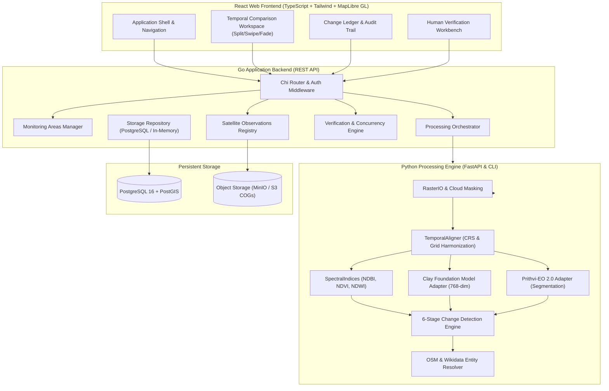
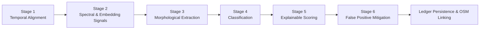

# satellite-infrastructure-change-ledger

[](./Makefile)
[](https://golang.org)
[](https://python.org)
[](https://reactjs.org)
[](./LICENSE)

**satellite-infrastructure-change-ledger** is an open-source geospatial platform for monitoring, analyzing, documenting, and verifying physical infrastructure changes using multi-temporal Earth observation satellite imagery.

---

## 1. Executive Summary

Maintaining an accurate, verifiable record of physical infrastructure growth is essential for planning, compliance, environmental assessment, and supply chain tracking.

Most conventional tools are either static dashboards, basic GIS viewers, or simple visual split-screen toys. **satellite-infrastructure-change-ledger** treats physical infrastructure changes as **documented, auditable observations** that must be backed by multi-sensor evidence, analyzed across time, linked to real-world geographical entities, and reviewed by human analysts.

### Initial Category: Industrial Infrastructure & Logistics Park Expansion

The initial release is focused on **industrial parks, warehouses, factories, and logistics corridors**.

**Example Scenario (Apex Industrial Logistics Park):**

- **2016 Baseline Observation:** Mostly undeveloped agricultural grassland with high vegetation reflectance (NDVI > 0.65), a natural pond, and a single rural building.
- **2021 Observation:** Major logistics estate expansion with four massive distribution warehouses, concrete aprons, an asphalt spine road network, and altered land cover.

---

## 2. System Architecture



---

## 3. Technology Stack

- **Go (Primary Application Backend):** REST API, RBAC, projects, monitoring areas, change ledger revisions, optimistic concurrency locking, and audit logs.
- **Python (Geospatial & ML Processing Engine):** Raster preprocessing, bilinear spatial coregistration, spectral index deltas (NDBI, NDVI, NDWI), morphological region extraction, and model adapters.
- **React + TypeScript + Vite + Tailwind CSS:** Dark cartographic UI, synchronized MapLibre viewports, swipe divider, opacity sliders, and review queues.
- **PostgreSQL 16 + PostGIS:** Spatial polygons, geometric bounding boxes, and relational revision history.
- **MinIO / S3:** Cloud Optimized GeoTIFF (COG) storage and preview tiles.

---

## 4. Multi-Stage Change Detection Pipeline



1. **Stage 1: Temporal Alignment:** CRS normalization (EPSG:4326 / EPSG:3857), bounding box intersection, and bilinear spatial resampling to harmonize pixel grids.
2. **Stage 2: Spectral & Embedding Signals:** Computes differential NDBI (built-up indicator), NDVI (vegetation loss), and extracts 768-dimensional patch representations via the `Clay` foundation model.
3. **Stage 3: Morphological Region Extraction:** Adaptive thresholding, morphological opening (eliminating noise) and closing (bridging structural components), followed by connected-component labeling and polygonization.
4. **Stage 4: Classification:** Assigns candidate categories: `new_construction`, `building_expansion`, `demolition`, `road_development`, `land_clearing`, or `vegetation_change`.
5. **Stage 5: Multi-Factor Explainable Scoring:** Generates explainable scores based on spectral magnitude, embedding distance, NDBI signal, and spatial compactness.
6. **Stage 6: False-Positive Mitigation:** Filters out seasonal vegetation shifts and low-contrast solar angle artifacts.

---

## 5. Foundation Model & Dataset Integrations

| Resource                                                | Role                                                   | Adapter Status       | Hardware / Fallback                        |
| :------------------------------------------------------ | :----------------------------------------------------- | :------------------- | :----------------------------------------- |
| **`made-with-clay/Clay`**                               | 768-dim patch representations & temporal distance      | `ClayAdapter`        | Apple Silicon / CUDA / CPU fallback        |
| **`ibm-nasa-geospatial/Prithvi-EO-2.0-600M-TL`**        | Semantic land cover segmentation & infrastructure mask | `PrithviAdapter`     | GPU or calibrated spectral rule fallback   |
| **`Major-TOM/Core-S2L2A`**                              | Systematic Sentinel-2 L2A tile grid discovery          | `MajorTomAdapter`    | Cloud COG indexer                          |
| **`wikimedia/linked-openstreetmap-wikidata-wikipedia`** | Real-world entity linking (OSM ways, Wikidata QIDs)    | `OsmWikidataAdapter` | Haversine proximity & spatial intersection |

---

## 6. Getting Started

### Prerequisites

- Go 1.22+
- Python 3.10+
- Node.js 20+ & pnpm (v9+)
- Docker & Docker Compose (optional, for containerized deployment)

### Local Development Setup

```bash
# 1. Clone repository
git clone https://github.com/ranajahanzaib/satellite-infrastructure-change-ledger.git
cd satellite-infrastructure-change-ledger

# 2. Environment configuration
cp .env.example .env

# 3. Install dependencies
make setup

# 4. Generate demo scenario rasters and run detection
make demo

# 5. Run automated test suites
make test
```

### Starting the Services Locally

In separate terminal sessions:

```bash
# Start Python Processing Worker (Port 8081)
PYTHONPATH=services/processing python3 services/processing/src/workers/server.py

# Start Go REST API (Port 8080)
cd services/api && go run ./cmd/server

# Start React Web Application (Port 3000)
pnpm dev
```

Open **`http://localhost:3000`** in your browser.

---

## 7. Running with Docker Compose

```bash
docker compose up --build
```

This spins up:

- PostgreSQL 16 + PostGIS on `localhost:5432`
- MinIO Object Storage on `localhost:9000` (Console on `localhost:9001`)
- Go REST API on `localhost:8080`
- Python Processing Worker on `localhost:8081`
- React Frontend on `localhost:3000`

---

## 8. Demonstration Scenario (`make demo`)

The demonstration scenario models the **Apex Industrial Logistics Park**:

- **2016-08-15 (T1 Baseline):** Undeveloped agricultural parcel with high vegetation (NDVI 0.72) and single small rural structure.
- **2021-07-10 (T2 Expansion):** Four large industrial distribution warehouses, concrete loading aprons, and asphalt access roads.
- **Outputs:**
  - True-color previews (`preview_2016_baseline.png`, `preview_2021_expansion.png`)
  - Difference heatmap raster
  - 5 change candidates with GeoJSON polygons, scores, and contributing signals
  - OSM / Wikidata linking to `Apex Logistics & Industrial Park` (`Q115893240`)
  - Complete revision audit trail

---

## 9. Automated Testing

Run the test suite at any time:

```bash
make test
```

- **Go API Tests:** Covers monitoring area CRUD, STAC discovery, change ledger filtering, analyst verification state transitions, optimistic concurrency conflicts (HTTP 409), role enforcement (Viewer HTTP 403), and exports (GeoJSON, CSV, Markdown).
- **Python Geospatial Tests:** Covers raster inspection, bilinear temporal alignment, spectral indices (NDBI, NDVI), Clay foundation embeddings, Prithvi segmentation, OSM proximity linking, and end-to-end change candidate polygonization.

---

## License

This project is licensed under the [MIT License](./LICENSE).
