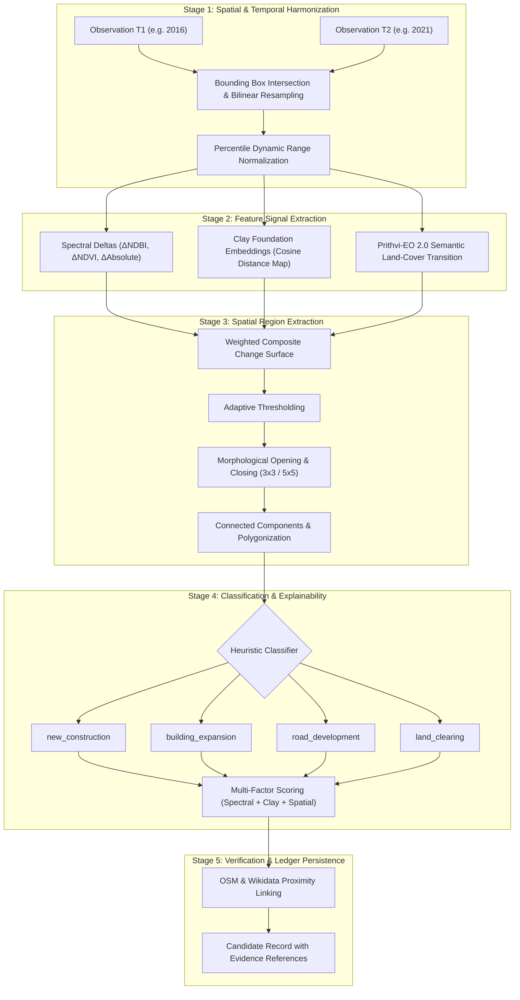

# Multi-Stage Change Detection Pipeline

The change detection engine does not rely on a simple difference threshold. It uses an ensemble of complementary signals:

## Contributing Signals

- **Spectral Magnitude (0.25 weight)**: Shift in multi-spectral reflectance.
- **Embedding Distance (0.30 weight)**: Cosine distance from `made-with-clay/Clay` 768-dim patch representations.
- **NDBI Built Signal (0.25 weight)**: Increase in Normalized Difference Built-up Index (SWIR - NIR) indicating new concrete or metallic roofs.
- **Spatial Compactness (0.20 weight)**: Ratio of region area to bounding box area, prioritizing coherent structural footprints over linear noise.
