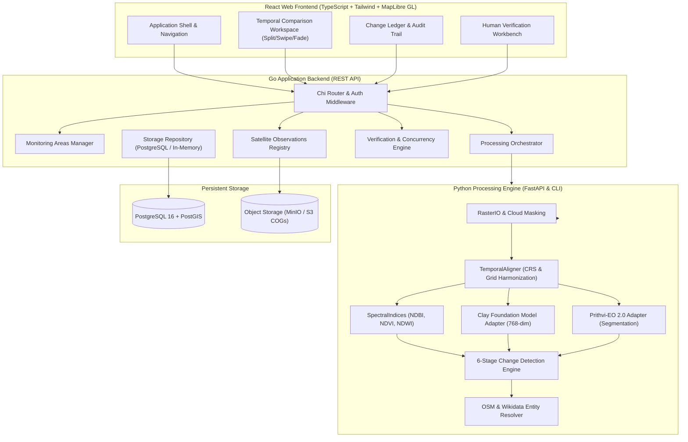

# System Architecture: satellite-infrastructure-change-ledger

`satellite-infrastructure-change-ledger` is an open-source geospatial platform for monitoring, analyzing, documenting, and verifying physical infrastructure changes using multi-temporal satellite imagery.

## Key Architectural Principles

1. **Documented Observations vs. Facts**: Every detected physical change is treated as an observation requiring evidence and human analyst confirmation before being certified in the ledger.
2. **Separation of Concerns**: Go manages high-concurrency API requests, user roles, transactions, and audit revisions; Python handles numerical raster processing, matrix operations, and foundation model inference.
3. **Resilience & Zero-Dependency Standalone Mode**: The platform functions seamlessly with PostgreSQL/PostGIS and MinIO in Docker, and also supports native local execution with deterministic test datasets and CPU-compatible model adapters.
