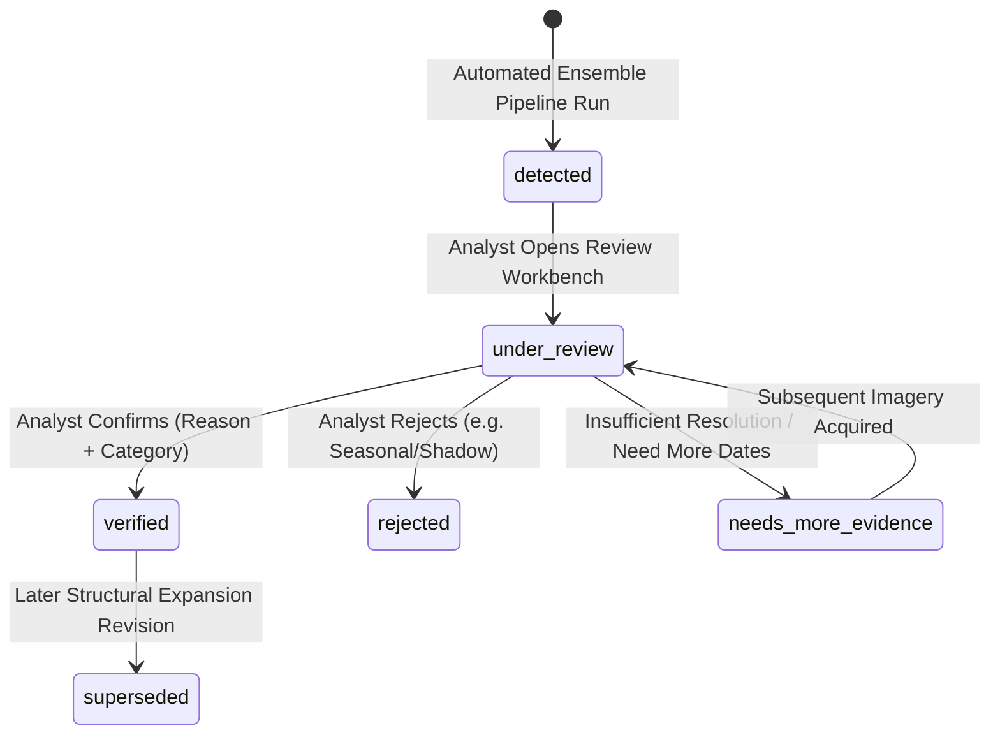

# Human Verification Workflow & State Machine

Human analyst verification is a core requirement of the ledger. Automated inferences never overwrite or silently mutate the registry.

## Concurrency Control

Every verification decision requires sending `concurrency_version` matching the candidate's current `revision_number`. If another analyst modified or verified the candidate concurrently, the API returns `409 Conflict`, preventing silent overwrites.

## Immutable Revisions

When a candidate is verified or rejected:

1. The candidate's `revision_number` increments.
2. An immutable `ChangeRevision` is written recording previous status, new status, decision reason, corrected category, and analyst notes.
3. An `AuditEvent` is written with analyst ID, action type, and IP address.
